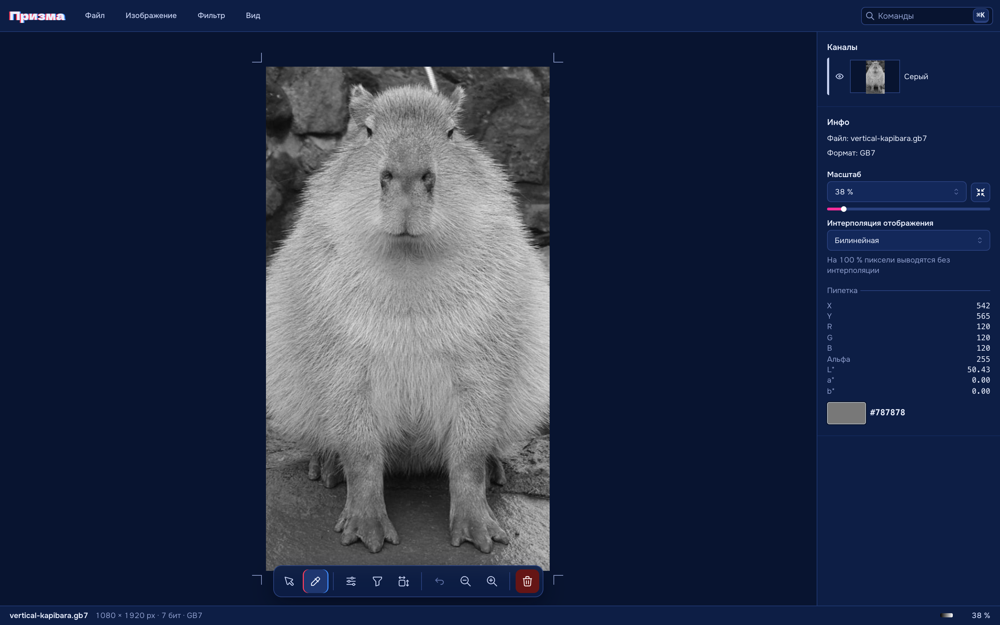

# Призма

Веб-редактор изображений, небольшой аналог Photoshop или GIMP. Все операции с пикселями написаны вручную; браузер только декодирует и кодирует PNG и JPEG.



## Запуск

```bash
pnpm install && pnpm dev    # разработка
pnpm test                   # тесты
pnpm lint && pnpm typecheck # проверки
docker compose up --build   # образ на http://localhost:8080
```

## Этапы проекта

| Этап | Что сделано                                           | Где найти                                  |
| ---- | ----------------------------------------------------- | ------------------------------------------ |
| 1    | Открытие и сохранение PNG, JPG, GB7; строка состояния | `Ctrl/Cmd+O`, `Ctrl/Cmd+S`, перетаскивание |
| 2    | Каналы и пипетка (RGB, CIELAB)                        | панель «Каналы», `I`                       |
| 3    | Гистограмма и «Уровни»                                | `Ctrl/Cmd+L`                               |
| 4    | Масштаб 12–300 % и изменение размера                  | `Ctrl/Cmd+= / − / 0 / 1`, `Ctrl/Cmd+Alt+I` |
| 5    | Свёртка 3×3 с пресетами                               | `Ctrl/Cmd+Shift+F`                         |
| —    | Отмена, возврат к исходному, палитра команд           | `Ctrl/Cmd+Z`, «Файл», `Ctrl/Cmd+K`         |

Каждое изменение создаёт новую версию (до 10 или ~512 МБ); исходные пиксели не перезаписываются. Изображение сохраняется в браузере и восстанавливается после перезагрузки.

## Детали

**GB7** — серое изображение без сжатия: заголовок 12 байт (`47 42 37 1D`, версия `01`, флаги — бит 0 «есть маска», ширина и высота uint16 big-endian, 2 байта резерва), затем по байту на пиксель. Биты 0–6 — серое 0–127, бит 7 — маска. Чтение `round(v·255/127)`, запись `round(Y·127/255)`, где `Y = 0.299R + 0.587G + 0.114B`.

**Уровни:** `t = (v − чёрный) / (белый − чёрный)`, результат `t^(1/γ)`, гамма 0.1–9.9; считается через таблицы подстановки.

**Интерполяция:** ближайший сосед и билинейная, отсчёт `src = (dst + 0.5) / масштаб − 0.5`, цвет смешивается с учётом альфы. Новый метод — одна функция в реестре.

**Свёртка:** `round(Σ вес·пиксель / делитель + смещение)`; края — повтор, чёрный или белый. Пресеты: тождественное, резкость, Гаусс, прямоугольное размытие, два ядра Прюитта (смещение 128). Расчёт идёт в Web Worker.

**CIELAB:** sRGB → линейный RGB → XYZ (D65) → L\*a\*b\*.

## Устройство кода

```
src/
  commands/    реестр команд: название, клавиши, доступность, действие
  components/  интерфейс
  hooks/       горячие клавиши, открытие файлов
  store/       состояние, версии, операции
  lib/         алгоритмы над пикселями, кодеки, Web Worker
```

Меню, панель инструментов, горячие клавиши и палитра строятся из одного реестра команд. `lib/image` не зависит от React и DOM.

Стек: TypeScript, React 19, Vite, Mantine 9, Zustand, Vitest.

## Ограничения

- Полупрозрачные пиксели PNG могут сдвинуться на шаг округления (premultiplied alpha в canvas).
- PNG сохраняется как 8-битный RGBA; JPEG не хранит прозрачность.
- Изображения больше ~50 МП открываются с предупреждением; GB7 — до 2²⁸ пикселей.
- Медианного фильтра нет.
